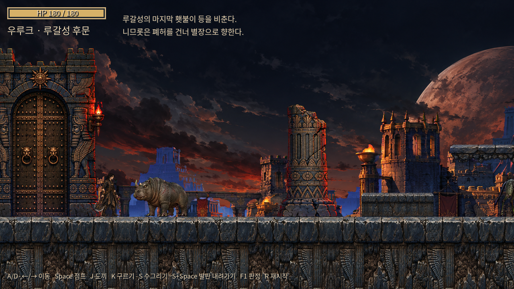
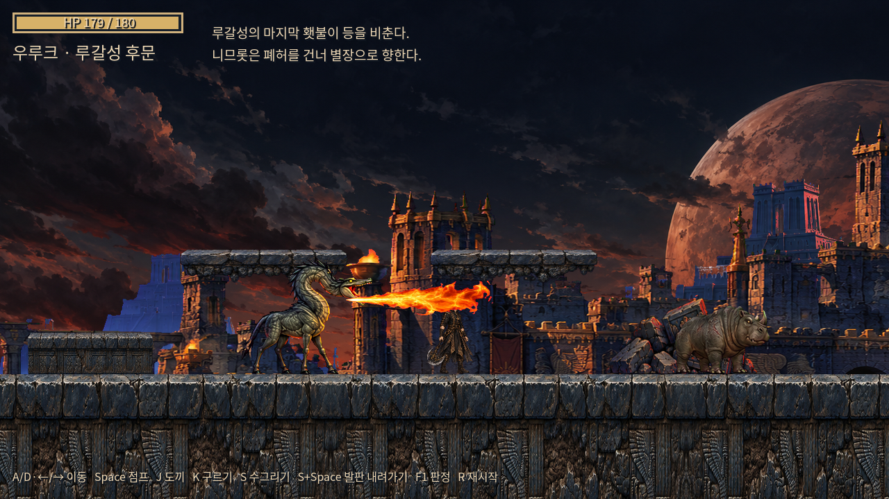
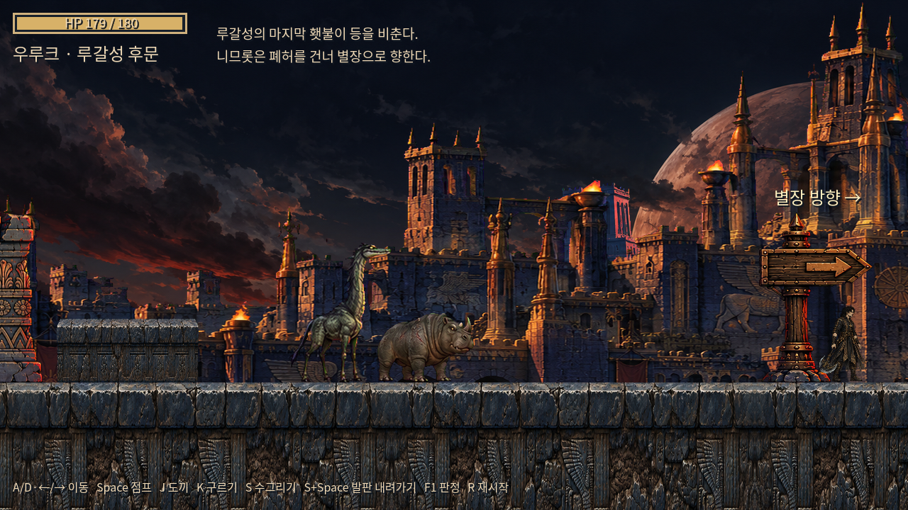

# NIMROD 우루크 루갈성 후문 구현 보고서

첨부 v7.1 프로젝트를 기존 /workspace/Nimrod 체크아웃에 통합했습니다. 이번 범위는 후문 밖 전투·이동 구간과 후속 확장을 위한 데이터·오디오·아트 구조입니다. 도입 문구와 별장 방향 표시를 구현했습니다. 실제 문 상호작용·별장 지역·스토리 분기·최종 엔딩은 후속 단계입니다.

## 사용자 요청에 따른 전경 제거 업데이트

사용자가 첨부한 마젠타 배경의 전경 원본 이미지를 삭제하도록 요청해 게임의 전경 레이어도 함께 제거했습니다. 다음 세 파일을 배포본에서 삭제했습니다.

- assets/backgrounds/rear_gate/foreground.png — 게임용 전경 이미지
- assets/source_art/foreground_source.png — 마젠타 배경 생성 원본
- assets/image_prompts/rear_gate_foreground.md — 전경 생성 프롬프트

scripts/rear_gate_layout.gd의 레이어 설정, assets/art_manifest.json, assets/source_art/map_provenance.json, tools/build_map_assets.py, tests/regression.gd의 연결 설정·재생성·검사 기준을 함께 갱신했습니다. tools/validate_assets.py는 갱신한 manifest에 따라29개를 검사합니다. 현재 파랄랙스는 하늘·먼 도시·루갈성 외벽의 3겹이고, 생성 게임 PNG와 프롬프트는 각각29개입니다. 문서와 시작·중간·출구 스크린샷도 현재 구성에 맞췄습니다.

업데이트는 기존 별도 브랜치 `codex/nimrod-rear-gate-godot43`로 전달합니다. [프로젝트 ZIP 다운로드](https://github.com/GreeceloveofOtto/Nimrod/archive/refs/heads/codex/nimrod-rear-gate-godot43.zip).

## 구현·보존

- 공격 중 K는 실제 좌우 입력을 읽고 facing/roll_direction/flip을 즉시 갱신합니다. 선딜·활성·후딜, S, 공중4타에 같은 규칙을 적용하며 공격 취소와 콤보1 초기화를 유지합니다.
- HP180, 도끼20/20/20/22, 구르기0.48(0.03/0.25/0.20), 콤보 리셋0.8, 히트스톱0.05, 일반 피격0.45, 사망 재시작1.6초를 유지합니다. 원본 플레이어 PNG18개는 ZIP과 바이트 단위로 동일합니다.
- 옵션형 피격 API와 일반 유예를 부여하지 않는 화염 경로를 구현했습니다. 화염은0.09초 간격11회(0.00~0.90), 총11 피해. 첫 수용 틱만0.18초 경직이고 구르기 무적은 계속 적용됩니다.
- 괴수 상태 머신, TURN3번째 프레임 flip, 후딜 보장, 넉백·경직 상한, 히트스톱, 스파크, 피격·사망 오디오를 구현했습니다. 원거리 선딜/활성 중 타격은 화염과 반복음을 즉시 중단합니다.
- 원본 플레이어가 바닥과 같은 레이어1이므로 적 마스크3과 한쪽 몸체 충돌이 발생할 수 있어 명시적 상호 충돌 예외를 추가했습니다. 플레이어 마스크3 / 적 레이어4·마스크3은 유지합니다.
- 도끼 끝 위치가 가까운 적의 중심을 지나가면 넉백 부호가 반전되던 오류를 물리 검사로 발견했습니다. take_hit의3인수 구조를 유지하고 공격자의 원점을 전달해 양방향 모두 적을 바깥으로 밀도록 수정했습니다.
- 폭3600, 시작x260, 안전구역0~200, 단차2, 일방향 발판2, 괴수5, 출구3400~3600, 한글 HUD를 구현했습니다.
- 현재 아트 PNG29종을 실제 이미지 생성 도구로 제작했습니다. 원본 확인 후 공통 다크 판타지·우루크 프롬프트를 사용했습니다. _draw는 F1 판정만 그립니다. 이미지 누락 시 회색 MISSING 폴백을 표시합니다.

## 가정·명세 외 선택 및 보정

| 항목 | 최종 값·이유 |
|---|---|
| 근접 괴수2 | x1900의 두 번째 개체 한 마리로 해석; 총 근접3/원거리2 |
| 마지막 근접 위치 | x2920; x2800 원거리와 몸이 겹치지 않게 배치 |
| 단차 폭 | 180/200px; 높이60/90px은 그대로 |
| 발판 x | 1120/1480; y700·폭240·충돌두께16·그림높이48 |
| E 표시 거리 | 145px; 프롬프트만 표시 |
| 도입 문구 | 7초; 폐허를 건너 별장으로 향한다는 짧은 분위기 문구 |
| 원거리 visual_scale | 0.33에서0.36으로 조정; idle552px → 약199px |
| 몸체 판정 | 근접150x90 / 원거리126x198 |
| 경직 상한 뒤 유예 | 누적0.6초 소진 뒤0.12초 일반 경직 면역 |
| 사망 연출 | 근접0.7/원거리0.8 사망 클립 후0.4초 페이드; 판정은 즉시 해제 |
| 끊긴 공격 | STUN 후 남은/전체 후딜을 지불한 다음 회전 가능 |
| 점프 변형 | 0.20/0.22/0.24초, 저음83/102/124Hz, 서로 다른 노이즈 시드 |
| 착지 / BGM | 0.12초 / 48초 주기, 드론 위상과 드럼 꼬리를 맞춤 |
| 스파크 | 5프레임0.15초, 배율0.24 |
| 화염 아트 | 6프레임0.36초, 실제 알파 영역 크기로220x60 표시를 맞춤 |
| 근접 recovery | 생성 windup4포즈의 역순; 같은 포즈로 몸을 다시 올림 |
| 원거리 원본 | 세운 목 원본 공통배율3.2632; 접힌 목 flame/death 원본0.56 보정; turn2프레임 오른쪽 기준 보정 |
| 바닥 타일 | 생성 이미지 좌우32px만 블렌드해 경계 동일; 새 지형 그림 생성 없음 |
| 한글 폰트 | Noto KR에서 UI162문자 부분화, SIL OFL 전문 보존 |

전투 음원의 명세 외 길이는 tools/make_sfx.py의 SOUNDS 표에 모았습니다. 합성 음원18개는44100Hz·모노·16bit·피크≤-3dBFS. 기존 jump.wav는 legacy/jump.wav로 원본 그대로 이동했습니다.

## 테스트 결과

- 공식 Godot4.3 Linux ZIP의 SHA512를 공식 체크섬과 대조한 엔진으로 검사했습니다.
- Godot4.3 editor import, check-only 및 headless 실행: 통과.
- tests/regression.gd: **166개 검사, 실패0, 종료코드0**, 오류·리소스 누수 없음.
- 실제 K 입력/공격 단계·무입력·S·공중, 피해·유예·구르기 무적, 실제 점프·착지음, 적 HP·경직·히트스톱·턴·후딜, 화염11틱·인터럽트, 도끼/충격파 물리 쿼리·중복 방지·근거리 넉백, F1, 맵 충돌·몸체 통과·출구·1.6초 재시작을 실행했습니다.
- tools/validate_assets.py: **PNG29개, 누락0, 오류0**. 크기·프레임·RGBA·알파·앵커·서로 다른 포즈·fps·파랄랙스 너비·타일 경계를 검사했습니다.
- tools/build_map_assets.py 재실행: 성공. 남은 PNG·데이터는 바이트 동일하며 삭제한 전경을 다시 만들지 않습니다.
- 실제 카메라 이동2320px에서3겹의0.05/0.20/0.45 비율과 끝단 이미지 범위를 검사했습니다.
- Xvfb/Mesa llvmpipe의 GL Compatibility에서1280x720 시작·화염 전투·출구를 렌더링하고 스크린샷3개를 갱신했습니다. 최종 캡처 종료코드0, 화면 오류 없음. 가상 디스플레이의 V-Sync 미지원 경고와 종료 시 이름 없는 AudioStreamWAV2개·AudioStreamPlaybackWAV2개의 ObjectDB 경고가 있습니다. 노드 누수는 없습니다.
- Godot4.3 오디오 검사: BGM-10/SFX0, 점프3스트림·피치, 착지, 화염 반복음 중단·해제,48초 BGM 반복·페이드, 누락 음원 경고 처리 통과.
- 합성 도구 재실행의 음원 해시 동일성과 원본18PNG/legacy jump 바이트 보존을 확인했습니다.
- 배포 ZIP을 별도 폴더에 풀고 엔진 캐시 없이 처음 가져온 뒤 회귀166개/실패0을 확인했습니다. ZIP에는 생성 원본·문서·스크린샷을 포함하고 .git/.godot/.import/.uid/Python 캐시·엔진 실행 파일은 제외했습니다.
- 오디오 종료 시 트윈·재생·스트림 참조·캐시를 정리합니다. 일반 회귀 검사는 깨끗하게 종료합니다. --quit-after180 강제 종료와 일부 렌더 캡처 종료에는 Godot4.3의 대기 중인 WAV 재생 객체에 대한 ObjectDB 경고가 남습니다. 실행 중 기능 오류는 없으며 종료코드는0입니다.

## 재사용할 클라우드 환경 설정

cloud-environment-onboarding:setup 스킬에 따라 install_script/start_skill 초안을 환경 설정 도구에 저장했습니다. 설치 스크립트는 공식 Godot4.3과 SHA512 검증, Python 도구 의존성, 최초 가져오기와 PNG 검증을 준비합니다. 실제 스크립트 실행은 통과했습니다. 시작 지침에는 기존 체크아웃 사용, 로컬 Godot 실행 경로, 캐시 디렉터리, 아트·전투 규칙과 검사 명령을 기록했습니다.

초안 저장 결과는 requires_publish=true입니다. 환경 설정에서 내용을 검토·저장하고 게시해야 이후 클라우드 환경에 적용됩니다. 게시와 새 환경 복원 검증은 아직 하지 않았습니다. 저장된 초안은 기존 저장소·네트워크·변수·비밀 설정을 유지합니다.

## 실행하지 못한 항목과 이유

- 실제 스피커 청감: 이 환경은 Dummy 오디오 드라이버를 사용합니다. 음질·볼륨 균형은 직접 청취할 항목입니다.
- 장시간 사람의 조작감·애니메이션 미적 자연스러움: 자동 물리·프레임·정지화면 검증을 수행했으나 사람의 장시간 플레이 평가는 아닙니다.
- Windows 배치/GPU 실행: 실행 머신이 Linux입니다.
- 엔딩·별장 지역·문 열기: 이번 단계는 프롬프트/별장 방향 라벨까지만 구현하는 명세입니다.
- 종료 시 오디오 ObjectDB 경고 해소: 일반 오디오 정리 후에도 --quit-after 강제 종료와 일부 렌더 캡처 종료에는 엔진의 대기 중인 재생 객체 경고가 남습니다. 일반 회귀 검사는 해당 경고 없이 종료합니다.

미생성 이미지: **없음**. 전경 제거 요청을 반영한 현재29개 PNG와 프롬프트·manifest가 있습니다.

## 화면

## 변경·추가 파일

첨부 ZIP과 비교한 목록입니다. .godot/.import/.uid 등 엔진 캐시는 제외했습니다.

- assets/audio/jump.wav — legacy/jump.wav로 이동
- .gitignore — 추가
- PLAY_WITH_GODOT.bat — 수정
- README.md — 추가
- README_KO.txt — 수정
- assets/art_manifest.json — 추가
- assets/audio/bgm/uruk_rear_gate.wav — 추가
- assets/audio/jump_a.wav — 추가
- assets/audio/jump_b.wav — 추가
- assets/audio/jump_c.wav — 추가
- assets/audio/land.wav — 추가
- assets/audio/legacy/jump.wav — 추가
- assets/audio/sfx/axe_hit_flesh.wav — 추가
- assets/audio/sfx/axe_hit_heavy.wav — 추가
- assets/audio/sfx/beast_melee_attack.wav — 추가
- assets/audio/sfx/beast_melee_death.wav — 추가
- assets/audio/sfx/beast_melee_hurt.wav — 추가
- assets/audio/sfx/beast_melee_windup.wav — 추가
- assets/audio/sfx/beast_ranged_death.wav — 추가
- assets/audio/sfx/beast_ranged_flame_loop.wav — 추가
- assets/audio/sfx/beast_ranged_flame_start.wav — 추가
- assets/audio/sfx/beast_ranged_hurt.wav — 추가
- assets/audio/sfx/beast_ranged_windup.wav — 추가
- assets/audio/sfx/player_hurt.wav — 추가
- assets/audio/sfx/shockwave.wav — 추가
- assets/backgrounds/rear_gate/castle_wall.png — 추가
- assets/backgrounds/rear_gate/far_city.png — 추가
- assets/backgrounds/rear_gate/sky.png — 추가
- assets/fonts/FONT_LICENSE.txt — 추가
- assets/fonts/NimrodUIKorean-Regular.otf — 추가
- assets/image_prompts/hit_spark.md — 추가
- assets/image_prompts/melee_beast_attack.md — 추가
- assets/image_prompts/melee_beast_death.md — 추가
- assets/image_prompts/melee_beast_hurt.md — 추가
- assets/image_prompts/melee_beast_idle.md — 추가
- assets/image_prompts/melee_beast_recovery.md — 추가
- assets/image_prompts/melee_beast_turn.md — 추가
- assets/image_prompts/melee_beast_walk.md — 추가
- assets/image_prompts/melee_beast_windup.md — 추가
- assets/image_prompts/ranged_beast_death.md — 추가
- assets/image_prompts/ranged_beast_flame.md — 추가
- assets/image_prompts/ranged_beast_flame_loop.md — 추가
- assets/image_prompts/ranged_beast_hurt.md — 추가
- assets/image_prompts/ranged_beast_idle.md — 추가
- assets/image_prompts/ranged_beast_recovery.md — 추가
- assets/image_prompts/ranged_beast_turn.md — 추가
- assets/image_prompts/ranged_beast_walk.md — 추가
- assets/image_prompts/ranged_beast_windup.md — 추가
- assets/image_prompts/rear_gate_castle_wall.md — 추가
- assets/image_prompts/rear_gate_exit_signpost.md — 추가
- assets/image_prompts/rear_gate_far_city.md — 추가
- assets/image_prompts/rear_gate_ground_tile.md — 추가
- assets/image_prompts/rear_gate_platform.md — 추가
- assets/image_prompts/rear_gate_rear_gate_door.md — 추가
- assets/image_prompts/rear_gate_rubble.md — 추가
- assets/image_prompts/rear_gate_ruin_pillar_a.md — 추가
- assets/image_prompts/rear_gate_ruin_pillar_b.md — 추가
- assets/image_prompts/rear_gate_sky.md — 추가
- assets/image_prompts/rear_gate_step_block.md — 추가
- assets/props/exit_signpost.png — 추가
- assets/props/rear_gate_door.png — 추가
- assets/props/rubble.png — 추가
- assets/props/ruin_pillar_a.png — 추가
- assets/props/ruin_pillar_b.png — 추가
- assets/source_art/beast_provenance.json — 추가
- assets/source_art/castle_wall_source.png — 추가
- assets/source_art/far_city_source.png — 추가
- assets/source_art/fx_source.png — 추가
- assets/source_art/map_provenance.json — 추가
- assets/source_art/melee_atlas.png — 추가
- assets/source_art/props_source.png — 추가
- assets/source_art/ranged_atlas.png — 추가
- assets/source_art/ranged_compact_atlas.png — 추가
- assets/source_art/sky_source.png — 추가
- assets/source_art/terrain_source.png — 추가
- assets/sprites/enemies/melee_beast/attack.png — 추가
- assets/sprites/enemies/melee_beast/death.png — 추가
- assets/sprites/enemies/melee_beast/hurt.png — 추가
- assets/sprites/enemies/melee_beast/idle.png — 추가
- assets/sprites/enemies/melee_beast/manifest.json — 추가
- assets/sprites/enemies/melee_beast/recovery.png — 추가
- assets/sprites/enemies/melee_beast/turn.png — 추가
- assets/sprites/enemies/melee_beast/walk.png — 추가
- assets/sprites/enemies/melee_beast/windup.png — 추가
- assets/sprites/enemies/ranged_beast/death.png — 추가
- assets/sprites/enemies/ranged_beast/flame.png — 추가
- assets/sprites/enemies/ranged_beast/flame_loop.png — 추가
- assets/sprites/enemies/ranged_beast/hurt.png — 추가
- assets/sprites/enemies/ranged_beast/idle.png — 추가
- assets/sprites/enemies/ranged_beast/manifest.json — 추가
- assets/sprites/enemies/ranged_beast/recovery.png — 추가
- assets/sprites/enemies/ranged_beast/turn.png — 추가
- assets/sprites/enemies/ranged_beast/walk.png — 추가
- assets/sprites/enemies/ranged_beast/windup.png — 추가
- assets/sprites/fx/hit_spark.png — 추가
- assets/sprites/fx/manifest.json — 추가
- assets/tiles/rear_gate/ground_tile.png — 추가
- assets/tiles/rear_gate/platform.png — 추가
- assets/tiles/rear_gate/step_block.png — 추가
- data/enemies.json — 추가
- data/player_attacks.json — 추가
- default_bus_layout.tres — 추가
- docs/screenshots/rear_gate_exit.png — 추가
- docs/screenshots/rear_gate_middle.png — 추가
- docs/screenshots/rear_gate_start.png — 추가
- project.godot — 수정
- requirements-tools.txt — 추가
- scenes/Main.tscn — 수정
- scenes/Player.tscn — 수정
- scenes/RearGate.tscn — 추가
- scripts/arena.gd — 수정
- scripts/asset_visual.gd — 추가
- scripts/audio_manager.gd — 추가
- scripts/enemy_base.gd — 추가
- scripts/enemy_melee_beast.gd — 추가
- scripts/enemy_ranged_beast.gd — 추가
- scripts/game_constants.gd — 추가
- scripts/image_effect.gd — 추가
- scripts/player.gd — 수정
- scripts/rear_gate.gd — 추가
- scripts/rear_gate_layout.gd — 추가
- tests/regression.gd — 추가
- tests/render_capture.gd — 추가
- tools/ART_PIPELINE_KO.md — 추가
- tools/audio_common.py — 추가
- tools/build_beast_assets.py — 추가
- tools/build_map_assets.py — 추가
- tools/make_bgm.py — 추가
- tools/make_jump_sfx.py — 추가
- tools/make_sfx.py — 추가
- tools/pack_sprites.py — 추가
- tools/subset_ui_font.py — 추가
- tools/validate_assets.py — 추가
- docs/IMPLEMENTATION_REPORT_KO.md — 추가
