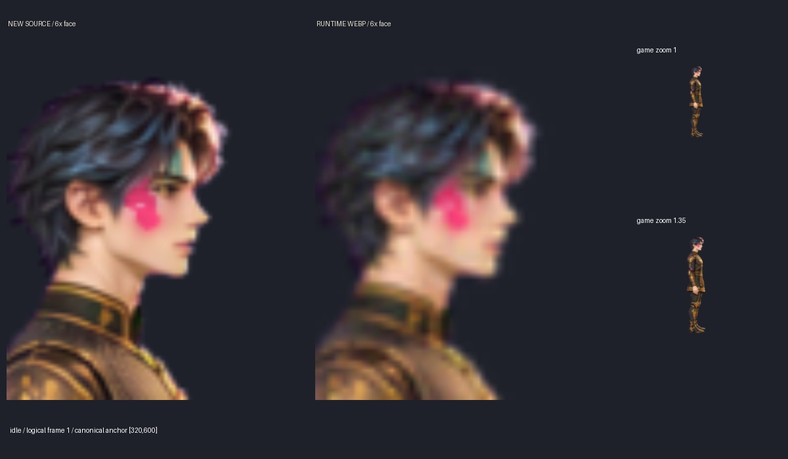
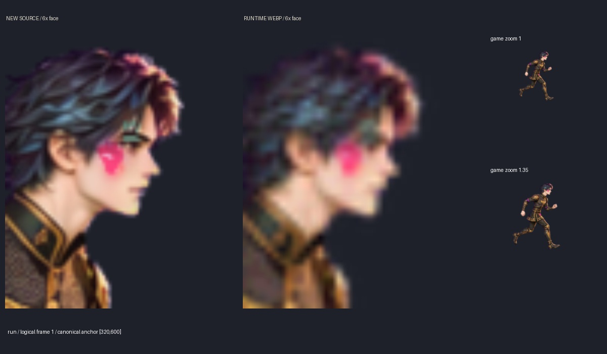
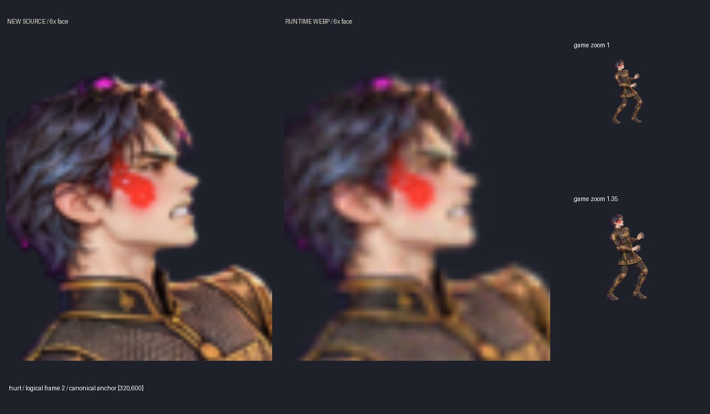
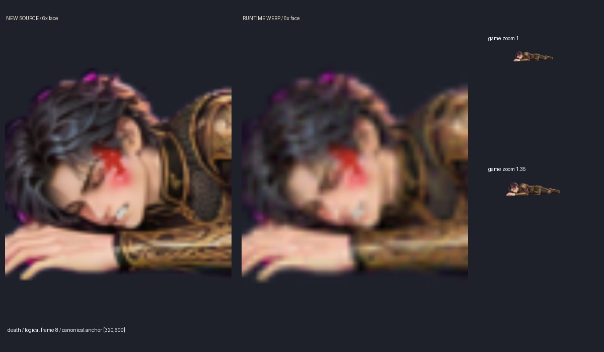

# 시야우와르샨 외형 검수

새 기준 시트와 17클립은 생성 이미지다. 아래4장은 새 canonical 원본과 런타임 WebP를 각각6배 확대한 얼굴, 게임 줌1.0/1.35의 몸 크기를 비교한다. JPG는 QA ZIP에만 포함하며 실행 ZIP에서는 제외한다.

idle: 평상시 입은 닫혀 있고 짧은 청흑색 머리·작은 귀·회녹색 눈·장밋빛 뺨을 확인한다.

run: 짧은 튜닉과 맨손, 경량 부츠, 닫힌 입을 확인한다.

hurt: 2번 프레임. 이를 악문 앞니·선홍 뺨·귀의 긴장을 확인한다.

death: 8번 마지막 프레임. 이를 악문 표정과 어두워진 선홍 뺨을 확인한다.

원본의 두 앞니 형태·귀의 크기·옷 길이는 수동 검수 대상이다. 낮은 게임 해상도에서는 치아 개수·3곳의 미세 흉터를 픽셀만으로 판독할 수 없다. 자동 검사 결과는 해당 색/영역 증거의 범위를 넘어서 해석하지 않는다. 전체 접촉 시트는 QA ZIP의 docs/siyavash_review/all_clips.jpg, 실제 장면8장은 같은 폴더의 runtime_*.png다.
